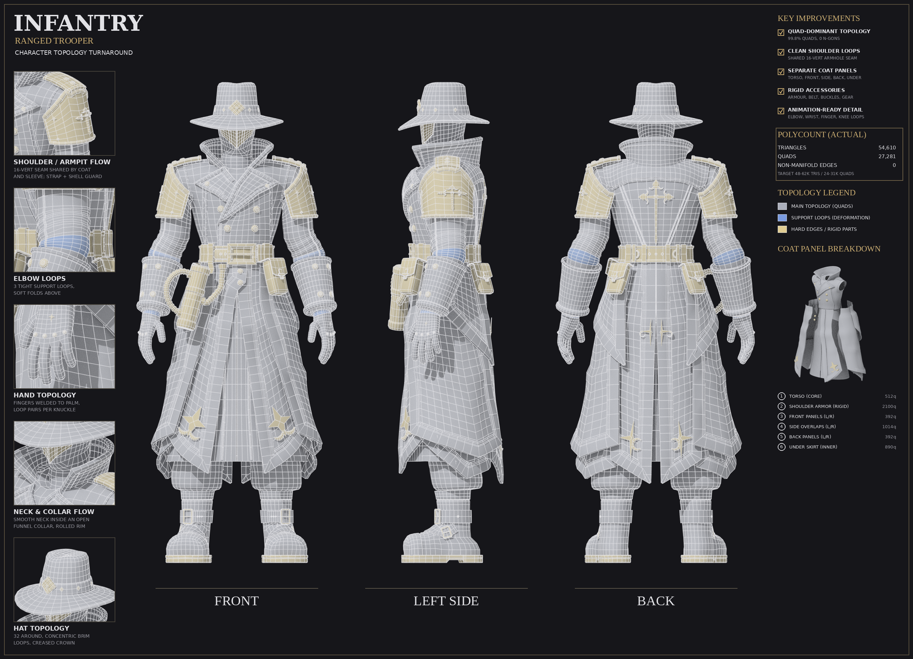

# Infantry Ranged Trooper

A procedural Blender (bpy) model of the character on the topology turnaround sheet in
`docs/reference.png`, built by six parallel part authors against one shared proportion spec.



```
pip install bpy pillow
python3 tools/build_all.py            # -> out/infantry_trooper.blend, .glb, stats.json + renders/turnaround_*.png
python3 tools/sheet.py                # -> renders/topology_sheet.png (reference-style presentation sheet)
python3 tools/preview.py arms         # build + render one part (stats, wireframe contact sheet)
python3 tools/compare.py --view FRONT # our render next to the reference crop + silhouette table
```

* `infantry/spec.py` - proportions and shared seams, re-measured from the reference (v3).
* `infantry/lib.py` - quad loft / tube / cap helpers and the shared detail vocabulary (trims, rivets, emblems).
* `infantry/parts/*.py` - head_hat, torso_coat, arms, armor_gear, skirt, legs; each `build()` returns objects
  tagged `main` / `support` / `rigid` (the sheet's legend colours).
* `docs/PLAN.md`, `docs/DETAIL_PASS.md` - the plan and the detail / review rounds.
